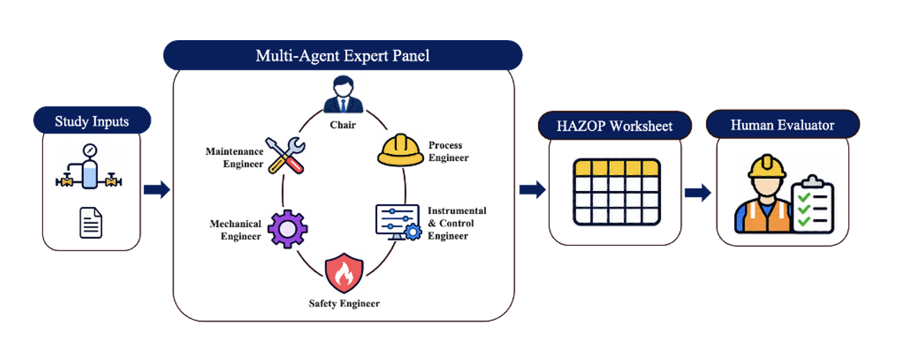

# HAZOP Automation through Multi-Agent Collaboration

**LLM-assisted hazard and operability studies for process systems**

A research implementation of a structured multi-agent HAZOP workshop. The backend coordinates a panel chair, P&ID image parser, five engineering specialists and a scribe/report agent, retaining scenario lineage, review decisions and evidence.

## Multi-Agent HAZOP Framework



*Framework overview of HAZOP automation through multi-agent collaboration.*

The review protocol separates scenario credibility from safeguard and action quality. Agreement is tracked separately from technical validity; incomplete review coverage and dissent are retained. The standalone P&ID parser provides local CV/OCR and vision-model fusion.

## Source code

| Module | Responsibility |
|---|---|
| [hazop_backend.py](src/hazop_backend.py) | Job orchestration, provider adapters, expert rounds, chair decisions, HTTP API and document export |
| [hazop_prompts.py](src/hazop_prompts.py) | Role-specific prompts, JSON schemas and evidence-grounding rules |
| [pid_parser.py](src/pid_parser.py) | OpenCV image processing, Tesseract OCR, tag extraction and optional vision fusion |
| [Technical report](docs/HAZOP_Technical_Report.docx) | Existing research report |

## Setup and verification

Python 3.10+ recommended. 
API keys are required for running the code.
From the repository root:

```bash
python -m venv .venv
# Activate the environment for your OS.
python -m pip install -r requirements.txt
python -m compileall -q src
python src/pid_parser.py path/to/drawing.png
```

Install the Tesseract executable separately for OCR. The backend uses Python standard-library HTTP clients for OpenAI, Anthropic, Gemini and Ollama. Model availability and credentials depend on the configured provider.

The backend expects its browser assets in `src/static/`; those assets were not supplied with this source release. Once the original frontend is present, start with `python src/hazop_backend.py` (default localhost port 8010). The separate CV parser can be exercised independently.

See [technical notes](docs/implementation.md) for endpoints and validation scope. AI-generated HAZOP findings require qualified engineering review before operational use.

